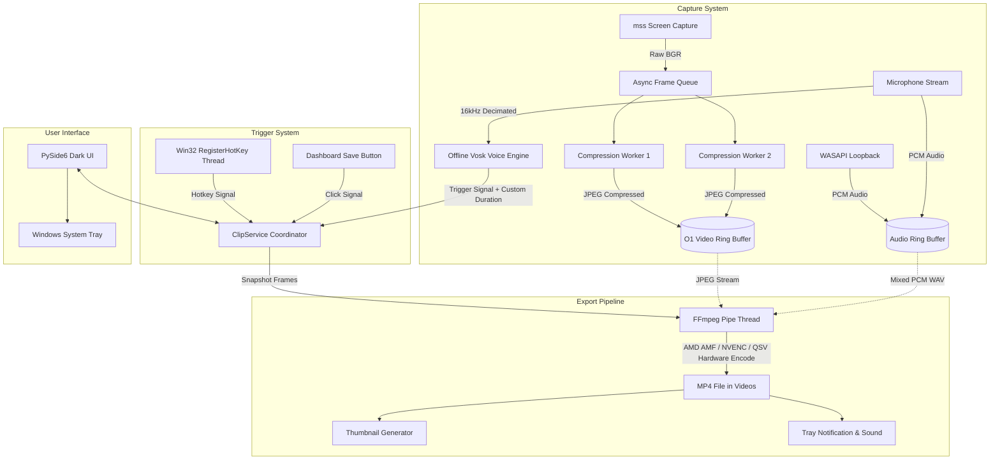

<div align="center">

  

  # Screen Clipper

  **Lightweight, Zero-Bloat Instant Replay & Screen Clipping for Windows.**

  [](https://github.com/Flopper1-1/screenclipper/releases)
  [-0078D6?style=for-the-badge&logo=windows)](https://github.com/Flopper1-1/screenclipper/releases)
  [](https://www.qt.io/)
  [](https://github.com/Flopper1-1/screenclipper)
  [](https://github.com/Flopper1-1/screenclipper)
  [](LICENSE)

  ---

  ### 🎬 Live Showcase

  

  <sub><i>Animated showcase created programmatically with <a href="https://www.remotion.dev/">Remotion</a> (source in <code>showcase/</code>).</i></sub>

</div>

---

## ⚡ Key Highlights

<table>
  <tr>
    <td width="50%">
      <h3>🎙️ Configurable Voice Trigger Phrases</h3>
      Say <b>"clip that"</b>, <b>"what a shot"</b>, or your own custom phrases into your microphone to automatically save clips. Each trigger can have its own independent clip duration (e.g. 15s, 30s, 60s). Easily add or remove voice triggers in Settings.
    </td>
    <td width="50%">
      <h3>🚀 Hardware-Accelerated Exporting</h3>
      Automatic hardware encoder detection for <b>AMD AMF (<code>h264_amf</code>)</b>, <b>NVIDIA NVENC (<code>h264_nvenc</code>)</b>, and <b>Intel QuickSync (<code>h264_qsv</code>)</b>. Cuts export times to fractions of a second with virtually 0% CPU consumption.
    </td>
  </tr>
  <tr>
    <td width="50%">
      <h3>🔄 Rolling Replay Buffer</h3>
      Continuously caches the last <b>5 to 300 seconds</b> of screen frames in an optimized in-memory ring buffer with O(1) memory accounting. Never waste hours of disk space searching for highlights.
    </td>
    <td width="50%">
      <h3>⚡ Asynchronous Capture Pipeline</h3>
      Decoupled screen capture and multi-threaded worker compression. Raw desktop grabbing runs independently of JPEG encoding, maintaining a rock-solid <b>60 FPS</b> throughput without micro-stutters.
    </td>
  </tr>
  <tr>
    <td width="50%">
      <h3>🔊 Dual WASAPI Audio Capture</h3>
      Pristine desktop audio recorded directly through Windows <b>WASAPI Loopback</b>. Optional microphone input channel with independent volume sliders and live stereo AAC muxing.
    </td>
    <td width="50%">
      <h3>⌨️ Global Win32 Hotkeys & Path Finder</h3>
      Low-level <code>RegisterHotKey</code> thread integration (<b>F9</b> to save, <b>F10</b> to pause/resume). One-click <b>"Show in Explorer"</b> highlights the exact MP4 file in Windows Explorer for instant sharing to Discord.
    </td>
  </tr>
</table>

---

## 🎙️ Voice Clipping (Speech-to-Clip)

Screen Clipper includes an offline, low-overhead speech recognition engine powered by Kaldi/Vosk:

- **Hands-Free Clipping:** Trigger clips while keeping both hands on your keyboard/mouse or controller.
- **Customizable Triggers:** Add phrases like *"clip that"*, *"save clip"*, *"insane play"*, or *"record this"*.
- **Per-Trigger Duration:** Specify exact lengths per phrase (e.g., set *"quick clip"* to 15s and *"full play"* to 60s).
- **Zero Cloud / 100% Offline:** Fully local acoustic decoding without internet connectivity or external speech services.
- **Smart Debouncing:** Built-in 3-second cooldown prevents accidental double-triggers.

---

## 🚀 Quick Start

1. **Download:** Head to the [Latest Releases](https://github.com/Flopper1-1/screenclipper/releases) and grab `ScreenClipper.exe`.
2. **Launch:** Run the executable. It sits quietly in your Windows system tray.
3. **Clip:** Whenever an epic moment happens on screen, press **`F9`** or say **`"clip that"`**!
4. **Access:** Click the tray notification or open the in-app **Clips Library** to play, copy the file path, or reveal it in Explorer.

> **Default Save Directory:** `%USERPROFILE%\Videos\ScreenClipper`

---

## 🖥️ Application Tour

### 🏠 Dashboard
- **Live Status:** Real-time indicator showing Buffering, Saving, Paused, or Voice Trigger states.
- **Resource Telemetry:** Monitored RAM buffer footprint, current FPS throughput, target resolution, and voice trigger status.
- **One-Click Capture:** Manual "Save clip now" button for quick tests.

### 🎞️ Clips Library
- Visual gallery displaying all recorded clips sorted chronologically.
- Automatic thumbnail preview generation.
- Quick actions:
  - **Show in Explorer:** Highlights the file in Explorer for instant drag-and-drop.
  - **Copy path:** Copies the full absolute path to the clipboard.
  - **Play:** Launches your default system media player.
  - **Delete:** Safely removes the clip and its thumbnail cache.

### ⚙️ Settings
- **Recording:** Buffer duration slider (5s – 300s), target resolution downscaler, capture frame rate, monitor selector.
- **Hotkeys:** Interactive key sequence recorder for clip saving and buffer toggle.
- **Voice Clipping:** Master toggle, live speech engine status, and a dynamic table to add or remove voice triggers with custom durations.
- **Audio Channels:** Toggle system audio loopback and microphone, with volume calibration (0% – 200%).
- **Storage & Automation:** Custom save directory, date format string, Windows autostart toggle, and notification sounds.

---

## 🏗️ Architecture



---

## 🛠️ Building From Source

### Prerequisites
- Python 3.12+ (64-bit)
- PowerShell (Windows 10 / 11)
- Node.js 18+ (only if re-rendering Remotion showcase animations)

### Setup & Compilation

```powershell
# Clone the repository
git clone https://github.com/Flopper1-1/screenclipper.git
cd screenclipper

# Install Python dependencies
pip install PySide6 mss PyAudioWPatch numpy opencv-python imageio-ffmpeg pyinstaller vosk

# Run the automated build script
powershell -ExecutionPolicy Bypass -File .\build.ps1
```

The resulting standalone executable will be compiled to `dist\ScreenClipper.exe` and automatically copied to your `Downloads` directory.

---

## 📜 License

Distributed under the **MIT License**. See [`LICENSE`](LICENSE) for more information.
