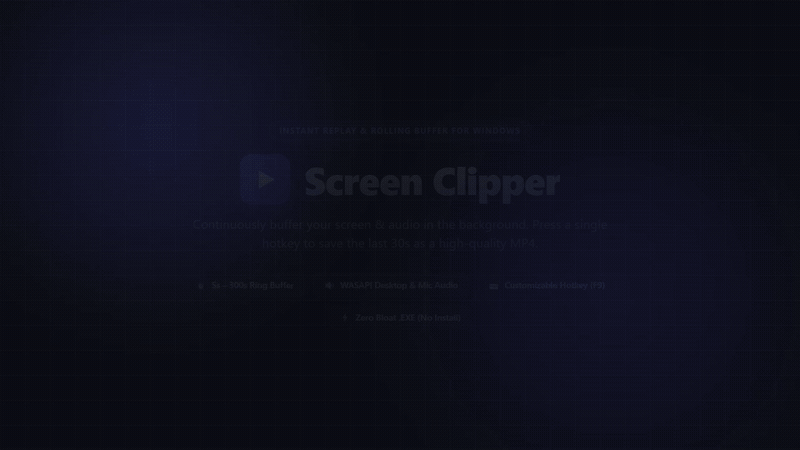
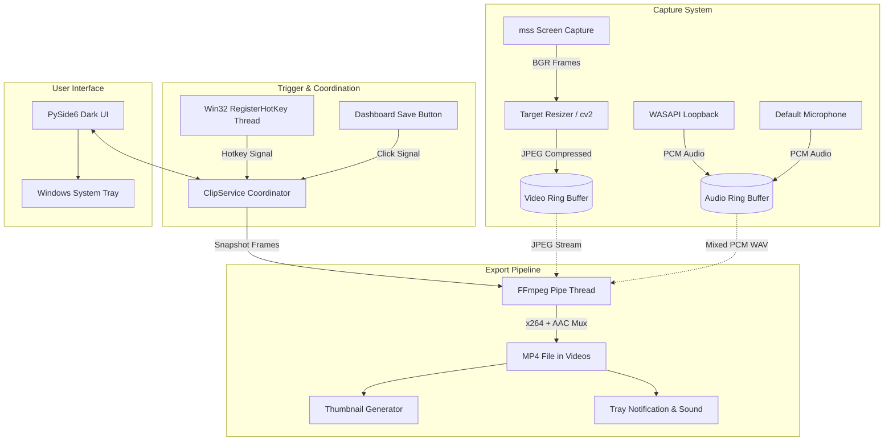

<div align="center">

  

  # Screen Clipper

  **Lightweight, Zero-Bloat Instant Replay & Screen Clipping for Windows.**

  [](https://github.com/Flopper1-1/screenclipper/releases)
  [-0078D6?style=for-the-badge&logo=windows)](https://github.com/Flopper1-1/screenclipper/releases)
  [](https://www.qt.io/)
  [](https://github.com/Flopper1-1/screenclipper)
  [](LICENSE)

  ---

  ### 🎬 Live Showcase

  

  <sub><i>Animated showcase created programmatically with <a href="https://www.remotion.dev/">Remotion</a> (source in <code>showcase/</code>).</i></sub>

</div>

---

## ⚡ Key Highlights

<table>
  <tr>
    <td width="50%">
      <h3>🔄 Rolling Replay Buffer</h3>
      Continuously caches the last <b>5 to 300 seconds</b> of screen frames in an optimized in-memory ring buffer. No need to record hours of footage to save a 15-second highlight.
    </td>
    <td width="50%">
      <h3>🔊 Dual WASAPI Audio Capture</h3>
      Pristine desktop audio recorded directly through Windows <b>WASAPI Loopback</b>. Optional microphone input channel with independent volume sliders and live stereo AAC muxing.
    </td>
  </tr>
  <tr>
    <td width="50%">
      <h3>⌨️ Global Win32 Hotkeys</h3>
      Low-level <code>RegisterHotKey</code> thread integration. Hit <b>F9</b> to clip instantly from any borderless game, browser, or app without window focus requirements.
    </td>
    <td width="50%">
      <h3>📁 Instant File Finder</h3>
      One-click <b>"Show in Explorer"</b> automatically selects and highlights the exact MP4 file in Windows Explorer for lightning-fast sharing to Discord, Telegram, or Twitter.
    </td>
  </tr>
  <tr>
    <td width="50%">
      <h3>⚙️ Deep Customization</h3>
      Customizable resolution (<b>Native, 1440p, 1080p, 720p, 480p</b>), frame rates (<b>15 / 30 / 60 FPS</b>), H.264 CRF quality levels, and timestamped filename templates.
    </td>
    <td width="50%">
      <h3>🪶 Zero-Install Standalone .EXE</h3>
      Packaged into a single self-contained executable with bundled FFmpeg. No Python installation, no external runtimes, no cloud accounts, and zero background telemetry.
    </td>
  </tr>
</table>

---

## 🚀 Quick Start

1. **Download:** Head to the [Latest Releases](https://github.com/Flopper1-1/screenclipper/releases) and grab `ScreenClipper.exe`.
2. **Launch:** Run the executable. It sits quietly in your Windows system tray.
3. **Clip:** Whenever an epic moment happens on screen, press **`F9`** (default).
4. **Access:** Click the tray notification or open the in-app **Clips Library** to play, copy the file path, or reveal it in Explorer.

> **Default Save Directory:** `%USERPROFILE%\Videos\ScreenClipper`

---

## 🖥️ Application Tour

### 🏠 Dashboard
- **Live Status:** Real-time indicator showing Buffering, Saving, or Paused states.
- **Resource Telemetry:** Monitored RAM buffer footprint, current FPS throughput, and target resolution.
- **One-Click Capture:** Manual "Save clip now" button for quick tests.

### 🎞️ Clips Library
- Visual gallery displaying all recorded clips sorted chronologically.
- Automatic thumbnail preview generation.
- Quick actions:
  - **Show in Explorer:** Highlights the file in Explorer for instant drag-and-drop.
  - **Copy path:** Copies the full absolute path to the clipboard.
  - **Play:** Launches your default system media player.
  - **Delete:** Safely removes the clip and its thumbnail cache.

### ⚙️ Settings
- **Recording:** Buffer duration slider (5s – 300s), target resolution downscaler, capture frame rate, monitor selector.
- **Hotkeys:** Interactive key sequence recorder for clip saving and buffer toggle.
- **Audio Channels:** Toggle system audio loopback and microphone, with volume calibration (0% – 200%).
- **Storage & Automation:** Custom save directory, date format string, Windows autostart toggle, and notification sounds.

---

## 🏗️ Architecture



---

## 🛠️ Building From Source

If you prefer to build `ScreenClipper.exe` locally from source:

### Prerequisites
- Python 3.12+ (64-bit)
- PowerShell (Windows 10 / 11)
- Node.js 18+ (only if re-rendering Remotion showcase animations)

### Setup & Compilation

```powershell
# Clone the repository
git clone https://github.com/Flopper1-1/screenclipper.git
cd screenclipper

# Install Python dependencies
pip install PySide6 mss PyAudioWPatch numpy opencv-python imageio-ffmpeg pyinstaller

# Run the automated build script
powershell -ExecutionPolicy Bypass -File .\build.ps1
```

The resulting standalone executable will be compiled to `dist\ScreenClipper.exe` and automatically copied to your `Downloads` directory.

---

## 🎥 Remotion Animations

The showcase animations in this README were created programmatically using **Remotion**:

```powershell
cd showcase
npm run build # or npx remotion render src/index.ts ScreenClipperShowcase ../assets/showcase.mp4
```

---

## 📜 License

Distributed under the **MIT License**. See [`LICENSE`](LICENSE) for more information.
